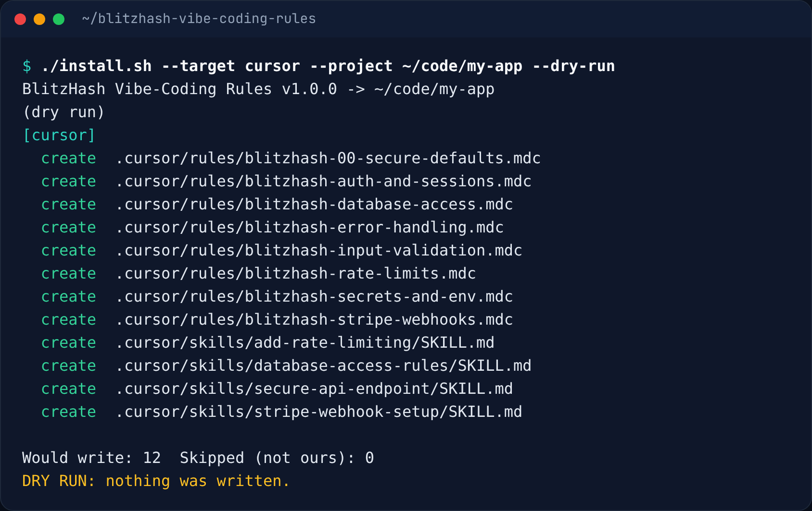
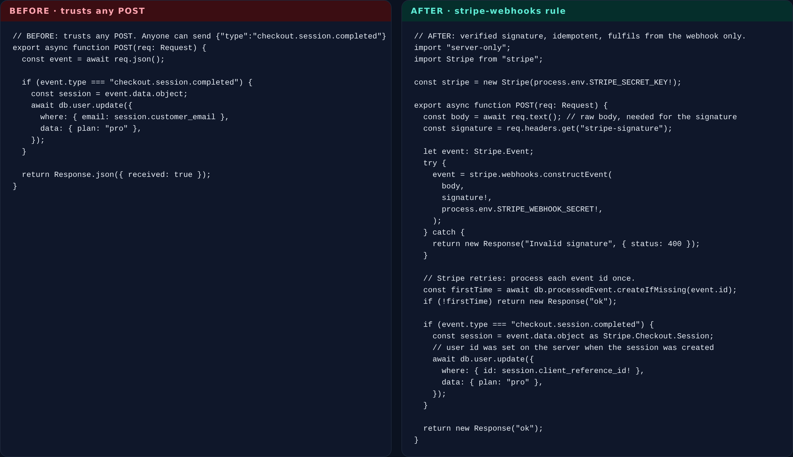

# BlitzHash Vibe-Coding Rules

**Make Cursor, Claude Code, Codex, Windsurf and Copilot write secure, launch-ready code by default: validated input, server-only secrets, verified Stripe webhooks, safe errors, locked-down database access, real auth checks and rate limits.**

[](LICENSE)
[](https://github.com/blitzhash360-web/blitzhash-vibe-coding-rules/actions/workflows/ci.yml)
[](install.sh)
[](docs/TOOLS.md)
[](https://blitzhash.com)

AI coding tools write the happy path well. They often skip the parts that hurt after launch: the webhook nobody verified, the API route anyone can call, the secret behind `NEXT_PUBLIC_`, the query built from a string. This pack gives your AI tool **8 short rules and 4 skills** so it writes those parts correctly the first time, without you having to remember to ask.


<sub>`./install.sh --target all --dry-run` lists every file it would write. Nothing is written until you drop `--dry-run`.</sub>

## Quick start (3 steps)

```bash
# 1. Get it (bash only: no Node, no npx, no account)
git clone https://github.com/blitzhash360-web/blitzhash-vibe-coding-rules && cd blitzhash-vibe-coding-rules

# 2. Preview what would go into your app (writes nothing)
./install.sh --target cursor --project ~/code/my-app --dry-run

# 3. Install, then build as usual: "Add a Stripe webhook for checkout"
./install.sh --target cursor --project ~/code/my-app
```

Targets: `cursor`, `claude` (Claude Code), `codex`, `agents-md` (any tool that reads `AGENTS.md`), `windsurf`, `copilot`, or `all`. Comma-separate to pick several: `--target cursor,claude`.

No bash? Copy [packs/AGENTS.md](packs/AGENTS.md) into your project root, or see [docs/TOOLS.md](docs/TOOLS.md#without-bash).

## What it does

### The rules

| Rule | Applies | What your AI tool will do |
|---|---|---|
| [`00-secure-defaults`](rules/00-secure-defaults.mdc) | always | A short baseline on every change: validate on the server, secrets server-side, check who and whether, least privilege, verified webhooks, fail closed, rate limits, never weaken protections to make something work. |
| [`input-validation`](rules/input-validation.mdc) | API routes, actions, server code | Schema-validate every input (zod, valibot, pydantic), block mass assignment, take identity from the session, safe uploads, SSRF and XSS guards, treat LLM output as input. |
| [`secrets-and-env`](rules/secrets-and-env.mdc) | config, server, `.env*` | No secrets behind public env prefixes, `server-only` modules, `.env.example` names only, never log keys, rotate first when something leaks. |
| [`stripe-webhooks`](rules/stripe-webhooks.mdc) | webhook, billing, checkout files | Verify `Stripe-Signature` on the raw body, idempotent by `event.id`, out-of-order safe, fulfil from the webhook, not the success page. |
| [`error-handling`](rules/error-handling.mdc) | code files | Generic messages plus a request id, real errors in server logs without secrets, fail closed, timeouts and safe retries. |
| [`database-access`](rules/database-access.mdc) | SQL, migrations, ORM, rules files | Parameterized queries, scope every query to the caller, Postgres RLS (Supabase as one example) and Firebase Security Rules done right, admin keys server-only, bounded lists. |
| [`auth-and-sessions`](rules/auth-and-sessions.mdc) | auth, middleware, API | Verify tokens on the server (Auth.js, Clerk, Firebase, Supabase), ownership checks, secure cookies, CSRF, safe redirects, reset links that do not leak accounts. |
| [`rate-limits`](rules/rate-limits.mdc) | API, actions, AI routes | Shared-store limits (Upstash, Redis, Cloudflare) on login, signup, forms and AI calls, 429 with `Retry-After`, per-user AI quotas and spend caps. |

Each topic rule has `Do`, `Never` and one copy-ready example. All 8 together are about 19 KB, so they fit comfortably in an `AGENTS.md`.

### The skills

For tools that support `SKILL.md` (Claude Code, Cursor, Codex). Skills load only when relevant.

| Skill | Use it for |
|---|---|
| [`secure-api-endpoint`](skills/secure-api-endpoint/SKILL.md) | "Add an endpoint for this button": auth, ownership, schema, errors, rate limit and tests for 401/403/400/429. |
| [`stripe-webhook-setup`](skills/stripe-webhook-setup/SKILL.md) | Payments that work end to end: raw body, signature, idempotency table, events to subscribe, `stripe listen` / `stripe trigger` tests. |
| [`database-access-rules`](skills/database-access-rules/SKILL.md) | Access matrix, RLS policies or Firebase rules as a migration, then tests with two real accounts and an anonymous one. |
| [`add-rate-limiting`](skills/add-rate-limiting/SKILL.md) | Pick limits per route, the right shared store for your host, 429 handling, AI quotas. |

### Before and after



```ts
// BEFORE: trusts any POST. Anyone can send {"type":"checkout.session.completed"}.
const event = await req.json();

// AFTER (stripe-webhooks rule): raw body + signature, or 400.
const body = await req.text();
event = stripe.webhooks.constructEvent(body, signature!, process.env.STRIPE_WEBHOOK_SECRET!);
```

More in [examples/](examples/README.md): an update-order route (no auth, mass assignment) and a search query (SQL injection), each with the fixed version.

### Where files go

| Tool | Files |
|---|---|
| Cursor | `.cursor/rules/blitzhash-*.mdc` + `.cursor/skills/` |
| Claude Code | `.claude/rules/blitzhash-*.md` (path-scoped) + `.claude/skills/` |
| Codex | `AGENTS.md` block + `.agents/skills/` |
| Any `AGENTS.md` tool | `AGENTS.md` block |
| Windsurf | `.windsurf/rules/blitzhash-*.md` (`always_on` / `glob` triggers) |
| GitHub Copilot | `.github/instructions/blitzhash-*.instructions.md` (`applyTo`) |

Details and loading behaviour per tool: [docs/TOOLS.md](docs/TOOLS.md). Fitting the rules to your stack: [docs/CUSTOMIZE.md](docs/CUSTOMIZE.md).

### Installer options

```text
--dry-run     show every file it would create, update, skip or remove; write nothing
--uninstall   remove only the files and AGENTS.md block it created
--no-skills   rules only
--yes         skip the confirmation (required in CI / non-interactive shells)
--list        list rules and skills
```

The installer never overwrites a file it did not create (it reports `skip`), keeps your existing `AGENTS.md` content, and is safe to re-run.

## How this fits with our other free tools

- **These rules prevent** problems while the code is being written.
- **[BlitzHash Senior Engineer Skills](https://github.com/blitzhash360-web/blitzhash-senior-engineer-skills) find** what already slipped through: launch-readiness audit, security review, scaling, cloud cost and backups, with a scanner that scores your project out of 100.
- **[BlitzHash Launch-Ready Check](https://github.com/blitzhash360-web/blitzhash-launch-ready-check) scans** your live URL for headers, leaked keys, rate limits, SEO and auth smells.

Use all three: rules while you build, skills before you launch, the URL check after you deploy.

## Going to production? What this doesn't cover

Rules make the AI's first draft much safer. They do not prove the app is safe. A real launch usually also needs:

- **A person reviewing the access rules table by table**, with two real accounts, including storage buckets and admin paths.
- **A penetration test** of auth flows, IDOR and business logic (coupons, refunds, credits), not just code patterns.
- **Key rotation and git-history cleanup** for anything that was ever committed or shipped in a bundle.
- **Load testing on staging**, and a plan for when your AI or payment provider is slow or down.
- **Monitoring and alerts** that reach a person, plus incident and rollback runbooks.
- **Tested backups**: a timed restore drill, not just a backup setting.
- **A cost model at 10x users** with spend caps on every provider.
- **Privacy and compliance basics** if you hold personal, health or payment data.

Want senior engineers to check yours? Book the **free 15-minute launch review call**: we look at your AI-built app and tell you what's risky. Free assessment at **[blitzhash.com](https://blitzhash.com)**.

## Development

```bash
npm ci                 # one dev dependency (yaml) used to double-check frontmatter in tests
npm test               # lint tests, link tests, real-YAML parse check, installer end-to-end tests (temp folders)
npm run lint           # rules + skills frontmatter, sections, size budgets, banned claims, secret scan
npm run links          # relative links and anchors (add :external to check web links)
npx markdownlint-cli2
shellcheck install.sh test/install.test.sh
```

CI runs all of the above on every push, installs the pack for every tool and checks that each format loads.

## Credits

- Rule and skill formats follow the public docs of [Cursor rules](https://docs.cursor.com/context/rules), [Claude Code memory and rules](https://docs.claude.com/en/docs/claude-code/memory), [AGENTS.md](https://agents.md), [Windsurf rules](https://docs.windsurf.com/windsurf/cascade/memories), [GitHub Copilot custom instructions](https://docs.github.com/en/copilot/how-tos/configure-custom-instructions/add-repository-instructions) and the open [Agent Skills](https://agentskills.io) `SKILL.md` convention.
- Security guidance draws on the [OWASP Cheat Sheet Series](https://cheatsheetseries.owasp.org/) (CC BY-SA 4.0; ideas only, no text copied) and [Stripe's webhook documentation](https://docs.stripe.com/webhooks).
- All rule text, skills, scripts and examples in this repo are original BlitzHash work under the MIT license. No third-party code is included.

Product names (Cursor, Claude Code, Codex, Windsurf, GitHub Copilot, Stripe, Supabase, Firebase, Next.js, Clerk, Auth.js, Upstash, Cloudflare, Prisma, Drizzle) are trademarks of their owners and are used only to describe compatibility. This project is not affiliated with or endorsed by any of them.

## License

MIT © BlitzHash. See [LICENSE](LICENSE).

---

Built by BlitzHash: need a senior team to check or scale your AI-built app? Free assessment at https://blitzhash.com
